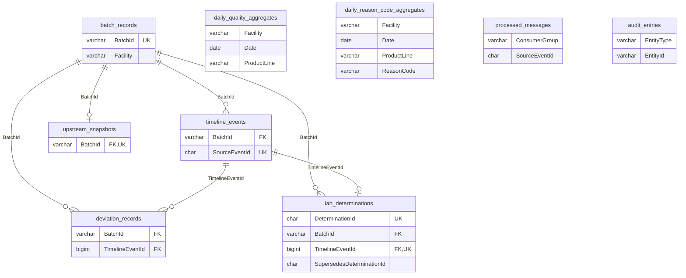

# Traceability Service: Database schema

What the Traceability database holds, table by table: columns, keys, the indexes and the queries they serve, the values stored in each coded column, and the sample data (SCRUM-120). Where the database is hosted, how to connect, the migration workflow and backups are in [database.md](database.md) (SCRUM-122).

---

## 1. Overview

Traceability Service keeps a **read model**: a copy of every batch's history, built from the other services' Kafka events and from lookups to the MCC and Intake Service. The trace and dashboard queries are answered from these tables alone, without calling the services that own the data.

| Table | One row per | Purpose |
|---|---|---|
| `batch_records` | Batch | The batch itself: status, product line, facility, how complete its trace is |
| `timeline_events` | Upstream event applied to a batch | The batch's history, in the order things happened |
| `upstream_snapshots` | Batch | What the MCC and Intake Service knows about the batch's dispatch: the dispatch note, tanks and consignments |
| `deviation_records` | Limit broken | What went out of range, by how much, and which event reported it |
| `lab_determinations` | Quality Lab determination | The lab's Cleared or Failed result, superseded ones included |
| `daily_quality_aggregates` | Facility, production day and product line | Pre-counted batches by status |
| `daily_reason_code_aggregates` | Facility, production day, product line and reason code | Pre-counted deviations by reason |
| `processed_messages` | Event handled by a consumer group | Stops an event redelivered by Kafka being applied twice |
| `audit_entries` | Change made by a user or a consumer | Who changed what, and when |



The two aggregate tables, `processed_messages` and `audit_entries` have no foreign keys.

---

## 2. Conventions

| Convention | Detail |
|---|---|
| Business key | `BatchId` (the batch code, e.g. `262-FM-B`) is `varchar(50)` everywhere. It is an alternate key on `batch_records`, and the child tables' foreign keys point at it rather than at `Id` |
| Facility | `varchar(50)`, the same value as the token's `facility` claim, e.g. `FACTORY-01`. Every dashboard query filters on it, so it leads the indexes those queries use |
| Coded columns | Enums (`Status`, `Completeness`, `Checkpoint`, `ResolutionStatus`, `Result`) are stored as the C# member name in a `varchar`, e.g. `Failed`, not `5`. The match is exact: `Mcc`, not `MCC` |
| Open-ended codes | `EventType`, `ProductLine` and `ReasonCode` are plain strings, so a new upstream event type, product line or reason needs no migration |
| Readings | `decimal(5,2)`: stored exactly, so 3.85 is 3.85 and not the nearest binary fraction |
| Timestamps | `datetime(6)`, in UTC |
| JSON | MySQL `json` columns hold payloads; read fields with `Payload->>'$.temperatureC'` |
| Event IDs | `char(36)` GUIDs: the upstream `EventId`, and Quality Lab's `DeterminationId` |
| Surrogate keys | `int` auto-increment; `bigint` for the tables that grow with every event (`timeline_events`, `processed_messages`, `audit_entries`) |
| Names | Tables `snake_case` and plural; columns `PascalCase`, matching the entity properties |

`deviation_records.Limit` is a reserved word in MySQL. EF quotes it; hand-written SQL must too: `` `Limit` ``.

Each table has an entity in `src/TraceabilityService/Domain/Entities` and its mapping in `src/TraceabilityService/Infrastructure/Persistence/Configurations`.

---

## 3. Tables

Null = the column accepts `NULL`. Every `Id` is the primary key.

### `batch_records`

| Column | Type | Null | Notes |
|---|---|---|---|
| `Id` | `int` | | Auto-increment |
| `BatchId` | `varchar(50)` | | Batch code `[day]-[product]-[set]`, e.g. `262-FM-B`. Unique |
| `DispatchRef` | `varchar(50)` | Yes | MCC dispatch number, e.g. `DN-20260919-02`. Null until an event that carries it arrives |
| `BatchReference` | `varchar(50)` | Yes | The reference factory intake gives the bowser's load, e.g. `WR-20260919-02`. Null until the upstream lookup resolves. See [Batch reference](#batch-reference) |
| `ProductLine` | `varchar(10)` | | Product code from the batch code. See [Product lines](#product-lines) |
| `Facility` | `varchar(50)` | | The factory the batch was made at, e.g. `FACTORY-01` |
| `Status` | `varchar(20)` | | See [Batch status](#batch-status) |
| `Completeness` | `varchar(20)` | | `Partial` or `Complete`. See [Completeness](#completeness) |
| `FirstEventAt` | `datetime(6)` | | Earliest `OccurredAt` among the batch's events |
| `LastEventAt` | `datetime(6)` | | Latest `OccurredAt`. Events can arrive out of order, so these are the minimum and maximum, not the first and last received |

| Index | Columns | Unique | Serves |
|---|---|---|---|
| `AK_batch_records_BatchId` | `BatchId` | Yes | Lookup by batch code; target of the child foreign keys |
| `IX_batch_records_DispatchRef` | `DispatchRef` | | A trace that starts from the dispatch number |
| `IX_batch_records_BatchReference` | `BatchReference` | | A trace that starts from the factory batch reference. Not unique: see below |
| `IX_batch_records_Facility_Status_LastEventAt` | `Facility`, `Status`, `LastEventAt` | | A facility's failed or on-hold batches, newest first |
| `IX_batch_records_Status_LastEventAt` | `Status`, `LastEventAt` | | The same across all facilities |
| `IX_batch_records_ProductLine_Status` | `ProductLine`, `Status` | | Counts by status within a product line, e.g. failed FM batches |
| `IX_batch_records_Facility_FirstEventAt` | `Facility`, `FirstEventAt` | | The societies panel: one facility's batches whose first event falls in the date window, before their snapshots are read. Not used when no facility is given |

#### Batch reference

A batch has three identifiers, each from a different service:

| Column | Example | Issued by | When |
|---|---|---|---|
| `DispatchRef` | `DN-20260919-02` | MCC and Intake Service, MCC side | The bowser leaves the chilling centre |
| `BatchReference` | `WR-20260919-02` | MCC and Intake Service, factory intake | The bowser passes screening at the factory gate (SCRUM-9) |
| `BatchId` | `262-FM-B` | Processing Service | The milk is allocated to a mixing tank |

No Kafka event carries `BatchReference`: the MCC and Intake Service publishes no events, and Processing's and Quality Lab's events carry `BatchId` and the dispatch number only. It comes from the same lookup as the upstream snapshot:

1. `GET /api/factory/batches?dispatchNote={DispatchRef}` returns the batch for that dispatch note, including its `reference`. A dispatch note produces at most one batch (unique in the MCC and Intake database), so the answer is unambiguous.
2. `GET /api/factory/batches/{reference}/trace` returns the dispatch note, tanks and consignments for the snapshot's `Payload`.

The index is not unique because Processing can split one dispatch across several mixing-tank batches, and each of them carries the same reference. A lookup by `BatchReference` can therefore return more than one row.

### `timeline_events`

| Column | Type | Null | Notes |
|---|---|---|---|
| `Id` | `bigint` | | Auto-increment |
| `BatchId` | `varchar(50)` | | → `batch_records.BatchId`, cascade delete |
| `Checkpoint` | `varchar(20)` | | `Mcc`, `Intake`, `Processing` or `Lab` |
| `EventType` | `varchar(100)` | | The upstream event name, e.g. `ProcessingStageRecorded`. See [Event types](#event-types) |
| `OccurredAt` | `datetime(6)` | | When it happened upstream, not when this service received it |
| `RecordedBy` | `varchar(100)` | Yes | Who recorded it upstream. Null for events raised by a system |
| `IsDeviation` | `tinyint(1)` | | 1 if the event reported anything out of range |
| `Payload` | `json` | | The event body as received. See [Payloads](#5-payloads) |
| `SourceEventId` | `char(36)` | | The upstream `EventId`. Unique |
| `ContractVersion` | `varchar(10)` | | The upstream `SchemaVersion`, e.g. `v1` |

| Index | Columns | Unique | Serves |
|---|---|---|---|
| `IX_timeline_events_SourceEventId` | `SourceEventId` | Yes | Replaying an event cannot add a second row |
| `IX_timeline_events_BatchId_OccurredAt` | `BatchId`, `OccurredAt` | | One batch's timeline, in order |
| `IX_timeline_events_OccurredAt` | `OccurredAt` | | Events across all batches in a time window |
| `IX_timeline_events_RecordedBy_OccurredAt` | `RecordedBy`, `OccurredAt` | | Everything one user recorded: the audit trail's user filter (SCRUM-138) |

### `upstream_snapshots`

One row per batch, created as soon as the batch is known, before the lookup to the MCC and Intake Service has run. That lookup is what reveals the consignments, so they are stored inside `Payload` rather than as rows of their own.

| Column | Type | Null | Notes |
|---|---|---|---|
| `Id` | `int` | | Auto-increment |
| `BatchId` | `varchar(50)` | | → `batch_records.BatchId`, cascade delete. Unique |
| `ResolutionStatus` | `varchar(20)` | | See [Resolution status](#resolution-status) |
| `Payload` | `json` | Yes | The whole upstream tree; see [Payloads](#5-payloads). Null until resolved |
| `AttemptCount` | `int` | | Lookups so far |
| `LastAttemptAt` | `datetime(6)` | Yes | Null until the first attempt |
| `ResolvedAt` | `datetime(6)` | Yes | Null until resolved |
| `FailureReason` | `varchar(500)` | Yes | Why the last attempt did not resolve, e.g. that upstream has no such dispatch, or returned an error. This is where "not found" and "failed" are told apart |
| `NextAttemptAt` | `datetime(6)` | Yes | When the retry worker may next try a `PendingRetry` row; pushed forward while an attempt runs, so no other worker takes it. Null for `Resolved` and `Unavailable`, and for rows from before retries were tracked, which are due at once |
| `LastCorrelationId` | `varchar(64)` | Yes | The `X-Correlation-ID` the last attempt sent upstream, for finding its log lines |

| Index | Columns | Unique | Serves |
|---|---|---|---|
| `IX_upstream_snapshots_BatchId` | `BatchId` | Yes | One snapshot per batch; backward trace |
| `IX_upstream_snapshots_ResolutionStatus` | `ResolutionStatus` | | Counting snapshots by status. Superseded for the resolver by the index below; kept because migrations are add-only |
| `IX_upstream_snapshots_ResolutionStatus_NextAttemptAt` | `ResolutionStatus`, `NextAttemptAt` | | The retry worker's due rows: `PendingRetry` with `NextAttemptAt` passed, oldest first |

A forward trace ("which batches did society VS014's milk reach?") has to look inside `Payload`, so it reads every resolved snapshot rather than using an index:

```sql
SELECT s.BatchId, c.reference
FROM upstream_snapshots s,
     JSON_TABLE(s.Payload, '$.tanks[*].consignments[*]'
         COLUMNS (reference varchar(100) PATH '$.reference',
                  society   varchar(10)  PATH '$.society.code')) c
WHERE c.society = 'VS014';
```

That is fine at the sample's size. If it becomes slow, MySQL 8.0 can index the societies inside the JSON with a multi-valued index, added in a migration with raw SQL.

### `deviation_records`

| Column | Type | Null | Notes |
|---|---|---|---|
| `Id` | `int` | | Auto-increment |
| `BatchId` | `varchar(50)` | | → `batch_records.BatchId`, cascade delete |
| `TimelineEventId` | `bigint` | | → `timeline_events.Id`, cascade delete. The event that reported it |
| `Checkpoint` | `varchar(20)` | | Copied from the event, so deviations can be counted without a join |
| `OccurredAt` | `datetime(6)` | | Copied from the event, for the same reason |
| `ReasonCode` | `varchar(50)` | Yes | Why it is a deviation. See [Reason codes](#reason-codes). Null when the upstream event only set its deviation flag |
| `Parameter` | `varchar(50)` | Yes | What was out of range, e.g. `TemperatureC` |
| `ObservedValue` | `decimal(5,2)` | Yes | The reading, e.g. `12.40`. Null for checks with no number, such as sensory grades |
| `Limit` | `decimal(5,2)` | Yes | The limit it broke, e.g. `4.00`. Null when `ObservedValue` is |
| `Description` | `varchar(500)` | Yes | Free text for the dashboard |

One event can produce several rows: a lab result with low pH and abnormal taste is two deviations.

| Index | Columns | Unique | Serves |
|---|---|---|---|
| `IX_deviation_records_BatchId_OccurredAt` | `BatchId`, `OccurredAt` | | One batch's deviations, in order |
| `IX_deviation_records_OccurredAt_Checkpoint` | `OccurredAt`, `Checkpoint` | | Deviations in a date range, split by checkpoint |
| `IX_deviation_records_ReasonCode_OccurredAt` | `ReasonCode`, `OccurredAt` | | One kind of deviation over time, e.g. every `TemperatureHigh` this month |
| `IX_deviation_records_TimelineEventId` | `TimelineEventId` | | The foreign key |

### `lab_determinations`

One row per Quality Lab determination (SCRUM-131). Quality Lab never edits a determination: a supersede publishes a new one that names the one it replaces. This table keeps both, so a batch's lab history shows what was decided first and what replaced it.

| Column | Type | Null | Notes |
|---|---|---|---|
| `Id` | `int` | | Auto-increment |
| `DeterminationId` | `char(36)` | | Quality Lab's `DeterminationId`. Unique |
| `BatchId` | `varchar(50)` | | → `batch_records.BatchId`, cascade delete. The event's `batchId`, which holds the batch code |
| `Result` | `varchar(20)` | | `Cleared` or `Failed`. See [Determination result](#determination-result) |
| `DeterminedAt` | `datetime(6)` | | When the lab made the determination: the event's `determinedAtUtc` |
| `DeterminedBy` | `varchar(100)` | | The analyst's user ID: the event's `determinedBy` |
| `SupersedesDeterminationId` | `char(36)` | Yes | The determination this one replaced: the event's `supersedesDeterminationId`. Null for a batch's first determination. Not a foreign key, because the replaced determination may never have reached this service, e.g. it was published before Traceability started consuming the topic |
| `IsSuperseded` | `tinyint(1)` | | 1 once a later determination names this one in `SupersedesDeterminationId` |
| `SupersededAt` | `datetime(6)` | Yes | The later determination's `DeterminedAt`. Null while this one is current |
| `TimelineEventId` | `bigint` | | → `timeline_events.Id`, cascade delete. The timeline row the `BatchCleared` or `BatchFailed` event was recorded as. A failure's out-of-spec parameters are `deviation_records` rows on that same timeline row |

A `BatchFailed` writes one `deviation_records` row per out-of-spec parameter, with the reason code for that parameter and bound (`FatPercent` below its minimum is `LOW_FAT`), and one more per listed reason code no parameter accounts for, such as `SENSORY_TASTE`. When the determination is superseded, its rows stay, but the aggregates stop counting them, so the dashboard reflects only current results.

A batch's current determination is its row with `IsSuperseded = 0`. The database does not enforce that there is only one: the consumer must add a supersede's row and mark the row it names in the same transaction.

| Index | Columns | Unique | Serves |
|---|---|---|---|
| `IX_lab_determinations_DeterminationId` | `DeterminationId` | Yes | A redelivered event cannot add a second row |
| `IX_lab_determinations_BatchId_DeterminedAt` | `BatchId`, `DeterminedAt` | | One batch's determinations, in the order they were made. Also serves the foreign key |
| `IX_lab_determinations_SupersedesDeterminationId` | `SupersedesDeterminationId` | | Finding the row a supersede replaces |
| `IX_lab_determinations_TimelineEventId` | `TimelineEventId` | Yes | One determination per timeline row; also the foreign key |

A failed batch's lab history, with the parameters that put it out of spec:

```sql
SELECT d.DeterminationId, d.Result, d.DeterminedAt, d.DeterminedBy, d.IsSuperseded,
       r.Parameter, r.ObservedValue, r.Limit
FROM lab_determinations d
LEFT JOIN deviation_records r ON r.TimelineEventId = d.TimelineEventId
WHERE d.BatchId = '262-FM-B'
ORDER BY d.DeterminedAt;
```

### `daily_quality_aggregates`

| Column | Type | Null | Notes |
|---|---|---|---|
| `Id` | `int` | | Auto-increment |
| `Date` | `date` | | The production day the batch code refers to: its leading day of the year, e.g. `262` in `262-FM-B`, in the year nearest the batch's `FirstEventAt` (`FactoryCalendar.ProductionDay`). For 2026 batches that is the sample data's `MAKEDATE(2026, 262)` |
| `ProductLine` | `varchar(10)` | | |
| `Facility` | `varchar(50)` | | |
| `BatchCount` | `int` | | Every batch. The four counts below add up to it |
| `PendingCount` | `int` | | Not decided and not held: `Chilling`, `Processing` or `AwaitingLab` |
| `ClearedCount` | `int` | | `Status = Cleared` |
| `FailedCount` | `int` | | `Status = Failed` |
| `OnHoldCount` | `int` | | `Status = OnHold` |
| `DeviationCount` | `int` | | All `deviation_records` rows for these batches, except those of a superseded lab determination: they are kept as the batch's history but no longer counted. Broken down by reason in `daily_reason_code_aggregates`, and by checkpoint in the four columns below |
| `MccDeviationCount` | `int` | | Deviations reported at the MCC |
| `IntakeDeviationCount` | `int` | | Deviations reported at factory intake |
| `ProcessingDeviationCount` | `int` | | Deviations reported during processing |
| `LabDeviationCount` | `int` | | Deviations reported by the lab. The four checkpoint counts add up to `DeviationCount`. They are stored rather than counted per request because `deviation_records` has no facility column, so a per-facility count would join it to `batch_records` every time |
| `UpdatedAt` | `datetime(6)` | | Last time the row was recalculated |

The dashboard's fail rate is `FailedCount / BatchCount` and is not stored. Pending and on-hold batches are in `BatchCount`, so the rate is the share of all the day's batches that have failed: a day the lab is still deciding reads low and rises as its batches fail, and it never disagrees with the "failed of batches" count shown beside it. With no batches the rate does not exist; show it as empty, not 0%.

| Index | Columns | Unique | Serves |
|---|---|---|---|
| `IX_daily_quality_aggregates_Facility_Date_ProductLine` | `Facility`, `Date`, `ProductLine` | Yes | One row per facility, day and product line; a facility's date window is a range scan on it |

### `daily_reason_code_aggregates`

| Column | Type | Null | Notes |
|---|---|---|---|
| `Id` | `int` | | Auto-increment |
| `Date` | `date` | | The production day |
| `ProductLine` | `varchar(10)` | | |
| `Facility` | `varchar(50)` | | |
| `ReasonCode` | `varchar(50)` | | A deviation with no reason is counted as `Unspecified` (`DailyReasonCodeAggregate.Unspecified`), because this column is part of the key |
| `DeviationCount` | `int` | | |
| `UpdatedAt` | `datetime(6)` | | Last time the row was recalculated |

For a facility, day and product line, the `DeviationCount`s here add up to `daily_quality_aggregates.DeviationCount`.

| Index | Columns | Unique | Serves |
|---|---|---|---|
| `IX_daily_reason_code_aggregates_Facility_Date_Line_Reason` | `Facility`, `Date`, `ProductLine`, `ReasonCode` | Yes | One row per key; the dashboard's breakdown by reason for a facility and date window. Named explicitly: the generated name is over MySQL's 64-character limit |

### `processed_messages`

| Column | Type | Null | Notes |
|---|---|---|---|
| `Id` | `bigint` | | Auto-increment |
| `ConsumerGroup` | `varchar(100)` | | The Kafka consumer group that handled the event |
| `SourceEventId` | `char(36)` | | The upstream `EventId` |
| `Topic` | `varchar(200)` | | e.g. `wonrich.processing.stage-events.v1` |
| `ProcessedAt` | `datetime(6)` | | |

Upstream relays deliver at least once, so the same event can arrive twice. A consumer must check this table before applying an event, and add its row in the same transaction as the change, so a crash cannot leave one without the other.

| Index | Columns | Unique | Serves |
|---|---|---|---|
| `IX_processed_messages_ConsumerGroup_SourceEventId` | `ConsumerGroup`, `SourceEventId` | Yes | The duplicate check. Per group, so two consumers of one topic each handle the event once |
| `IX_processed_messages_ProcessedAt` | `ProcessedAt` | | Clearing old rows by age |

### `audit_entries`

| Column | Type | Null | Notes |
|---|---|---|---|
| `Id` | `bigint` | | Auto-increment |
| `OccurredAt` | `datetime(6)` | | |
| `Actor` | `varchar(100)` | | The user ID from the token, or the consumer's name for changes made by event processing |
| `Action` | `varchar(100)` | | |
| `EntityType` | `varchar(50)` | | e.g. `Batch` |
| `EntityId` | `varchar(100)` | | e.g. the `BatchId` |
| `Details` | `json` | Yes | What changed |
| `CorrelationId` | `varchar(64)` | Yes | The request's `X-Correlation-ID`, to find the matching log lines |

| Index | Columns | Unique | Serves |
|---|---|---|---|
| `IX_audit_entries_EntityType_EntityId_OccurredAt` | `EntityType`, `EntityId`, `OccurredAt` | | The history of one record |
| `IX_audit_entries_OccurredAt` | `OccurredAt` | | Everything in a time window |
| `IX_audit_entries_Actor_OccurredAt` | `Actor`, `OccurredAt` | | The audit trail's user filter (SCRUM-138) |

Append-only (SCRUM-138): the triggers `audit_entries_no_update` and `audit_entries_no_delete` fail any `UPDATE` or `DELETE` with SQLSTATE `45000`, and the application refuses to save a changed or removed entry. See [audit-trail.md](audit-trail.md).

Written by:

| Action | EntityType | EntityId | Details |
|---|---|---|---|
| `BatchSearchExported` | `BatchSearch` | The export's file name | `{ fileName, rowCount, role, filters }`: the filters as applied, null where not given (SCRUM-139) |
| `BatchRecordOpened` | `Batch` | The `BatchId` | `{ role }` (SCRUM-138) |
| `BatchTraceOpened` | `Batch` | The `BatchId` | `{ role }` (SCRUM-138) |

---

## 4. Coded values

### Batch status

| Value | Meaning | SCRUM-135 |
|---|---|---|
| `Chilling` | At the MCC | pending |
| `Processing` | Past factory intake and in processing | pending |
| `AwaitingLab` | Processed; waiting for the lab result | pending |
| `OnHold` | Held, e.g. Processing raised a hold because the pasteuriser temperature was out of range | on hold |
| `Cleared` | Quality Lab's `BatchCleared` | cleared |
| `Failed` | Quality Lab's `BatchFailed` | failed |

The SCRUM-131 consumer moves a batch to `Failed` on `BatchFailed`, as its Definition of Done specifies. The team had also discussed putting failed panels on hold; the schema supports either, and the change would be one line in `DeterminationResolver`.

### Determination result

`lab_determinations.Result`. Unlike the batch status, this is what the lab decided, whatever the consumer does with the batch.

| Value | Quality Lab event |
|---|---|
| `Cleared` | `BatchCleared` |
| `Failed` | `BatchFailed` |

### Completeness

| Value | Meaning |
|---|---|
| `Partial` | A checkpoint has not reported yet, or the upstream snapshot is not resolved |
| `Complete` | Every checkpoint has reported and the upstream snapshot is resolved |

### Resolution status

| Value | Meaning |
|---|---|
| `PendingRetry` | Not looked up yet, or the last lookup failed and will be retried at `NextAttemptAt`. `FailureReason` holds the last error, if any |
| `Resolved` | Looked up; `Payload` holds the tree |
| `Unavailable` | Given up on. `FailureReason` says why: upstream has no such dispatch, or the retries ran out (`Upstream:MaxAttempts`) |

The rules that move a snapshot between these are in the README, under Upstream snapshots.

### Product lines

`FM`, `FLM`, `SY`, `SK`, `DY`, `CD`. Processing's event contract currently lists all but `CD`.

### Event types

| Source | Event types |
|---|---|
| Processing (`ProcessingService.Domain.Events`, record names without the `Event` suffix) | `MilkAllocatedToMixingTank`, `ProcessingStageRecorded`, `ProcessingCompleted`, `ProcessingHoldRaised`, `ProcessingHoldResolved` |
| Quality Lab | `BatchCleared`, `BatchFailed` |
| Placeholders, until those services publish contracts | `MccDispatchCreated` (MCC), `FactoryIntakeRecorded` (Intake) |

### Reason codes

| Value | Meaning in the sample data | Limit |
|---|---|---|
| `TemperatureHigh` | Above the limit leaving the MCC, at intake, or at the pasteuriser | 4.00, 5.00, 75.00 |
| `TemperatureLow` | Below the pasteurisation range | 72.00 |
| `PhLow` | pH below range | 6.60 |
| `PhHigh` | pH above range | 6.80 |
| `SensoryAbnormal` | Any sensory grade marked `Abnormal` | none |
| `Unspecified` | Only in `daily_reason_code_aggregates`: deviations whose event gave no reason | none |

The list is provisional and has not been agreed with the upstream services.

Lab deviations use Quality Lab's reason codes exactly as it sends them, e.g. `LOW_FAT`, `HIGH_PH`, `LOW_SNF`, `SENSORY_TASTE`, `CONTAMINATION`, so they are not in the list above. An unfamiliar code is stored and counted under its own name. A lab parameter with no known code is counted as `Unspecified`.

---

## 5. Payloads

### `timeline_events.Payload`

The event body exactly as received, so its fields follow each upstream contract; for Processing that is `ProcessingService.Domain.Events`. Measurements live here rather than in columns because each checkpoint reports a different set.

The sample data uses these shapes:

| Checkpoint | Payload |
|---|---|
| `Mcc`, `Intake` | `{"fatPercentage": 4.10, "snfPercentage": 8.72, "clrReading": 28.40, "temperatureC": 3.80}` |
| `Processing` | `{"stageType": "Pasteuriser", "endTemperatureC": 73.50}` |
| `Lab` | `{"result": "Cleared", "ph": 6.68, "appearance": "Normal", "texture": "Normal", "taste": "Normal", "colour": "Normal", "smell": "Normal"}` |

Check field names against the real contract before relying on them in a query.

### `upstream_snapshots.Payload`

**This is a contract.** The resolver (SCRUM-132) writes exactly this shape, and the batch record endpoint reads it: the MCC and Factory Intake sections and the links (dispatch → tanks → consignments → societies) all come from here. In code it is `UpstreamSnapshotPayload` (`Domain/Entities/UpstreamSnapshotPayload.cs`); write it with `UpstreamSnapshotPayload.Serialize` and read it with `UpstreamSnapshotPayload.Parse`, so both sides use the same field names and JSON options. Change the shape there and here together.

```json
{
  "batchReference": "WR-20260919-02",
  "dispatch": {
    "reference": "DN-20260919-02",
    "dispatchedAt": "2026-09-19T05:40:00Z",
    "dispatchedBy": "mcc.manager",
    "bowserRegistration": "BWR-02",
    "totalLitres": 910
  },
  "intake": {
    "arrivedAt": "2026-09-19T08:05:00Z",
    "screenedAt": "2026-09-19T08:05:00Z",
    "screenedBy": "intake.officer",
    "temperatureC": 9.80
  },
  "tanks": [
    {
      "code": "T1",
      "quantityDrawnLitres": 560,
      "consignments": [
        {
          "reference": "CON-20260919-VS009",
          "society": { "code": "VS009", "name": "Society VS009" },
          "volumeLitres": 300,
          "registeredAt": "2026-09-19T05:00:00Z",
          "registeredBy": "intake.officer.vs009",
          "panel": {
            "fatPercentage": 4.03,
            "snfPercentage": 8.52,
            "clrReading": 27.80,
            "temperatureC": 4.40,
            "verdict": "Accepted",
            "tightestMargin": 0.0024,
            "tightestMeasure": "Snf"
          }
        }
      ]
    }
  ]
}
```

| Field | Type | Required | Meaning | From the MCC and Intake Service |
|---|---|---|---|---|
| `batchReference` | string | Yes | The factory batch reference | `BatchTraceView.BatchReference` |
| `dispatch.reference` | string | Yes | The dispatch note | `DispatchNoteReference` |
| `dispatch.dispatchedAt` | timestamp | Yes | When the bowser left the MCC | `DispatchedAtLocal`, converted to UTC |
| `dispatch.dispatchedBy` | string | No | Who dispatched it | `DispatchedBy` |
| `dispatch.bowserRegistration` | string | No | | `BowserRegistration` |
| `dispatch.totalLitres` | number | Yes | Total on the dispatch note | `TotalDispatchedLitres` |
| `intake.arrivedAt` | timestamp | Yes | When the bowser reached the factory | `ArrivedAtLocal`, converted to UTC |
| `intake.screenedAt` | timestamp | Yes | When it passed screening | `ScreenedAtUtc` |
| `intake.screenedBy` | string | No | Who screened it | `ScreenedBy` |
| `intake.temperatureC` | number | No | Arrival temperature | `BatchView.ArrivalTemperatureCelsius`, from the lookup by dispatch note |
| `tanks[].code` | string | Yes | MCC tank | `TracedTankView.TankCode` |
| `tanks[].quantityDrawnLitres` | number | Yes | What the bowser drew from it | `QuantityDrawnLitres` |
| `tanks[].consignments[].reference` | string | Yes | The consignment | `TracedConsignmentView.Reference` |
| `…consignments[].society.code` | string | Yes | Village society | `SocietyCode` |
| `…consignments[].society.name` | string | No | | `SocietyName` |
| `…consignments[].volumeLitres` | number | Yes | | `QuantityLitres` |
| `…consignments[].registeredAt` | timestamp | Yes | When it was registered at the MCC gate | `RegisteredAtUtc` |
| `…consignments[].registeredBy` | string | No | Who registered it | `RegisteredBy` |
| `…consignments[].panel` | object | No | The gate quality test; absent if none was recorded | `QualityTest` |
| `…panel.fatPercentage` | number | Yes | | `FatPercent` |
| `…panel.snfPercentage` | number | Yes | | `Snf` |
| `…panel.clrReading` | number | Yes | | `CorrectedClr` |
| `…panel.temperatureC` | number | Yes | | `TemperatureCelsius` |
| `…panel.verdict` | string | Yes | | `Verdict` |
| `…panel.tightestMargin` | number | No | How close the closest measure came to the limit that would have rejected it, as a fraction of that limit: 0 is on it. Null when it could not be scored; do not copy the upstream `-1` placeholder | `TracedConsignmentView.TightestMargin` |
| `…panel.tightestMeasure` | string | No | Which measure that was, e.g. `Snf`, `FatPercent` | `QualityTest.Margins[0].Measure` (the list is tightest first) |

Rules:

- **Times are UTC**, written with a `Z`. The MCC and Intake Service's `…Local` fields are factory local time and must be converted before they are stored.
- **camelCase field names.** Fields not listed are ignored on read, so the resolver may store more without breaking anything; it may not rename or drop a required one.
- **Only when resolved.** `Payload` is null for `PendingRetry` and `Unavailable` rows; a partial tree is never stored.

How the batch record endpoint uses it:

| Part of the response | Reads |
|---|---|
| MCC section | One record for `dispatch` (time `dispatchedAt`, user `dispatchedBy`) and one per consignment (time `registeredAt`, user `registeredBy`, with its panel) |
| Factory Intake section | One record for `intake` (time `screenedAt`, user `screenedBy`) |
| Links | `dispatch` → `tanks` (code, quantity drawn) → `consignments` → `society` |
| `GET /api/dashboard/societies` | Every consignment's `society` and `panel.tightestMargin` / `tightestMeasure`, across the resolved snapshots of the batches in range. TR-12 is descoped, so there is no per-society table and this is parsed on each request |

---

## 6. Relationships and deletes

| Deleting | Also deletes |
|---|---|
| A `batch_records` row | Its `timeline_events`, `upstream_snapshots` row, `deviation_records` and `lab_determinations` |
| A `timeline_events` row | Its `deviation_records` and its `lab_determinations` row |

Nothing else cascades. Deleting a batch leaves its `audit_entries` (they are meant to outlive the rows they describe) and its `processed_messages` rows. It also leaves its figures in both aggregate tables, which then include a batch that no longer exists and have to be recalculated.

---

## 7. Migrations

| Migration | What it does |
|---|---|
| `20260920140432_InitialCreate` | The first model: `batch_traces`, `batch_sources`, `checkpoint_records` |
| `20260920172550_AddBatchTraceProductionDateStatusIndex` | Index on `batch_traces (ProductionDate, CurrentStatus)` |
| `20261010175413_ReplaceBatchTraceWithReadModel` | Drops the three original tables and creates the eight above. Down drops them and recreates the originals, empty |
| `20261011021748_AddBatchRecordBatchReference` | Adds the nullable `batch_records.BatchReference` and its index. Down removes both |
| `20261011182048_AddDailyAggregateCheckpointDeviationCounts` | Adds `MccDeviationCount`, `IntakeDeviationCount`, `ProcessingDeviationCount` and `LabDeviationCount` to `daily_quality_aggregates`, each defaulting to 0, and the index `IX_batch_records_Facility_FirstEventAt` for the societies panel. Existing rows are not backfilled: recalculate them, or reload the sample data. Down removes the four columns and the index |
| `20261012142627_AddLabDeterminations` | Creates `lab_determinations` and its four indexes. Adds nothing to existing tables. Down drops the table |
| `20261013041812_AddUpstreamSnapshotRetryTracking` | Adds the nullable `NextAttemptAt` and `LastCorrelationId` to `upstream_snapshots`, and the index `IX_upstream_snapshots_ResolutionStatus_NextAttemptAt` for the retry worker (SCRUM-132). Existing `PendingRetry` rows keep a null `NextAttemptAt`, which counts as due. Down removes both columns and the index |

`ReplaceBatchTraceWithReadModel` drops tables, which the rules in [database.md](database.md) do not normally allow. It is safe here only because the original tables never reached staging or production, so no deployed version depends on them. Any data in them is lost on upgrade; for a development database, reload it from the sample data. Later migrations must follow the add-only rule.

The integration tests cover the schema:

| Test class | Proves |
|---|---|
| `MigrationTests` | Every migration runs down and back up, including this one with data present |
| `DeviationRecordPersistenceTests` | `ObservedValue` and `Limit` are `decimal(5,2)` and store 3.85 and 8.64 exactly |
| `HealthEndpointTests` | The app applies every migration to an empty database on startup |

### Changing the schema

1. Change the entity in `Domain/Entities` and its mapping in `Infrastructure/Persistence/Configurations`. A new configuration class is picked up automatically.
2. Add a migration. EF starts the app to build the model, so it needs a connection string and a signing key; placeholders do, since nothing connects:

   ```bash
   dotnet tool restore
   ConnectionStrings__TraceabilityDb="Server=localhost;Database=traceability;User=dev;Password=dev;" \
   Auth__SigningKey="design-time-placeholder-signing-key-32-bytes-plus" \
   dotnet ef migrations add <MigrationName> --project src/TraceabilityService --output-dir Migrations
   ```

3. Read the generated migration, especially any `DropTable`, `DropColumn` or `RenameColumn`, and any index name ending in `~`: MySQL's 64-character limit truncated it, so give it a name with `HasDatabaseName`.
4. Update this document, `docs/sample-data.sql` and `docs/reset-data.sql`.
5. Run the integration tests (Docker needed): `dotnet test tests/TraceabilityService.IntegrationTests`.

---

## 8. Sample data

| Script | What it does |
|---|---|
| [`sample-data.sql`](sample-data.sql) | Loads 24 batches over 2026-09-16 to 2026-09-20 at `FACTORY-01`, four for each product line, covering every status, completeness and resolution status and every reason code above. Replaces those batches if they are already there |
| [`reset-data.sql`](reset-data.sql) | Removes them again. Leaves any other data alone |

Both can be run twice safely. `processed_messages`, `audit_entries` and `lab_determinations` are left empty, so the sample's `Cleared` and `Failed` batches have no determination rows.

```bash
mysql -h wonrichmysql.mysql.database.azure.com -u trc_app -p \
  --ssl-mode=REQUIRED traceability < docs/sample-data.sql
```

**Development and staging only.** Never load it into `traceability_prod`.

Batch `262-FM-B` is the demo batch for the backward trace: it fails at the lab, and its timeline shows the cause, 12.40C leaving the MCC against a 4.00C limit, three checkpoints earlier. The checks at the end of `sample-data.sql` list the expected row counts, status counts, pass rates and traces.
